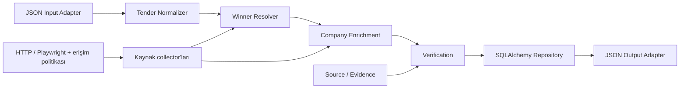

# TenderEnricher mimarisi — MVP

## Amaç ve sınır

Mevcut ihale kaydının kazananını ve kazanan tüzel kişinin açık kaynaklardaki
bilgilerini zenginleştirir. Yeni ihale keşfetmez. MVP yerelde, tek süreçte ve
sıralı çalışır. Önce bu sözleşmeler sabitlenir, sonra modüller uygulanır.

Core, dosya veya SQLAlchemy okumaz ve HTML parse etmez. Composition root
(`cli.py`) adapter ve provider'ları bağlar. Küçük `Protocol` interface'leri
yalnızca değişmesi beklenen sınırlar için kullanılır. Mikroservis, queue, LLM,
dağıtık görev sistemi ve genel plugin framework MVP'ye dahil değildir.

## Klasörler ve sorumluluklar

| Yol (`src/tender_enricher/` altında) | Sorumluluk |
| --- | --- |
| `models.py`, `ports.py` | Ortak Pydantic modelleri, küçük adapter/provider sözleşmeleri |
| `adapters/input/` | JSON kaydını okumak; kayıt bazında doğrulama hatası üretmek |
| `normalization.py` | İhale numarası, Türkçe metin ve firma alan normalizasyonu |
| `winner_resolution.py` | İhale–kazanan kanıtlarını değerlendirmek, belirsizliği korumak |
| `collectors/ekap/` | Verilen açık sonuç URL'lerindeki desteklenen etiketli HTML; portal oturumu yok |
| `collectors/company_website/` | Organization JSON-LD, açık iletişim alanları |
| `collectors/trade_registry/` | Açık HTML şirket kayıtları; login/ücretli PDF erişimi yok |
| `collectors/search/` | İsteğe bağlı Brave API ile yalnızca mevcut ihale/firma için URL keşfi |
| `collectors/web.py`, `browser.py` | Robots, rate limit, timeout, sınırlı retry, erişim korumasında durma |
| `matching.py` | İsim + resmi kimlik/domain/adres/şehir karşılaştırması; çelişkide ret |
| `enrichment.py` | Aday şirketleri toplamak, eşleşmeyen adayları ayırmak |
| `verification.py` | Alan bazında kaynak birleştirme, çelişki ve güven değerlendirmesi |
| `evidence.py` | Kaynak kimliği, içerik hash'i, URL, alım zamanı, publisher grubu |
| `db/` | SQLAlchemy tabloları, transaction ve repository; core'dan ayrı |
| `adapters/output/` | Sürümlenmiş JSON sözleşmesini atomik yazmak |
| `pipeline.py` | İş akışı; bir kaynağın hatasını diğer kaynaklardan izole etmek |
| `config.py`, `logging_config.py`, `errors.py` | Ayarlar, secrets, yapılandırılmış log, hata kategorileri |

`migrations/` Alembic, `schemas/` üretilen JSON Schema, `tests/` çevrimdışı
fixture ve birim/entegrasyon testleri, `data/demo/` tamamen sentetik demo içerir.

## Ortak veri modelleri

* `TenderInput`: tender_id, title, authority, location; opsiyonel award_urls,
  company_urls ve registry_urls. İlk dört alan mevcut sisteme yeterlidir.
* `NormalizedTender`: normalize edilmiş kayıt; proje lokasyonu firmanın şehri
  yerine kullanılmaz.
* `CompanyProfile`: company_name, phone, email, website, address, city, district,
  mersis_no, trade_registry_no, trade_registry_office, tax_no, tax_office.
  Bilinmeyen her alan `null`.
* `Source`: id, url, final_url, source_type, publisher_group, retrieved_at,
  content_sha256, is_demo. Güvenilirlik URL'nin bilinen kaynak sınıfından gelir;
  JSON girişindeki bir güven etiketi gerçek resmi kaynak yetkisi vermez.
* `Evidence`: id, field, value, source_id, excerpt, locator. Kazanan iddiası
  ayrıca ihale numarasıyla ilişkilendirilir; sadece sayfada firma adı geçmesi yetmez.
* `WinnerClaim` / `CompanyCandidate`: collector çıktısı; parser'ın yaptığı
  gözlem ile business logic'in kararı ayrı tutulur.
* `MatchDecision`: accepted, score, reasons. İsim tek başına kabul sağlamaz.
* `FieldVerification`: status, confidence, evidence_ids, alternatives.
* `EnrichmentResult`: schema_version, run_id, tender_id, status, winner,
  sources, evidence, field_verification, winner_confidence, confidence,
  completeness, issues, processed_at, is_demo.

`confidence` istatistiksel olasılık değildir; açıklanabilir kural skorudur.
Kazanan doğruluğu, alan doğrulaması ve veri tamlığı ayrı gösterilir. Aynı
yayıncının birden çok sayfası bağımsız doğrulama sayılmaz. Bağımsız domainler
bile birbirinden kopya olabilir; içerik hash'iyle birebir kopyalar tek sayılır.

## MVP kapsamı ve kabul kriterleri

1. JSON nesnesi veya dizisi okunur; bozuk kayıt diğer kayıtları durdurmaz.
2. Kazanan için tam ihale numarası ve açık kazanan/yüklenici etiketi aranır.
   Tek haber kaynağı otomatik onaylanmaz; resmi sonuç veya birden fazla
   bağımsız uyumlu kaynak gerekir. İptal/ortak girişim/çelişki incelemeye ayrılır.
3. Kaynak URL'leriyle gerçek HTTP çalışır; API anahtarı varsa isteğe bağlı URL
   keşfi yapılır. Anahtar/yeterli kaynak yoksa `unresolved` dönülür.
4. Organization JSON-LD ve desteklenen açık HTML etiketleri parse edilir.
   MERSİS/vergi/sicil bilgisi yalnızca açık sayfada gözlenirse alınır.
5. Resmi kimlik çelişkisi aday reddidir. Firma adı yanında domain, adres veya
   firma şehri gibi destekleyici sinyal olmadan otomatik birleştirme yapılmaz.
6. Kaynak/kanıt, retrieval zamanı ve alan skorları hem SQLite'ta hem çıktıda kalır.
   Alan çelişkisinde değer `null`, alternatifler kanıtlarda tutulur.
7. Kaynak hatası kayıtlı bir issue olur; kalan provider'lar çalışır.
8. Demo çevrimdışı ve sentetiktir; gerçek veri çıktısıyla karıştırılmaz.
9. Alembic migration, meaningful pytest testleri, lint/type check ve CLI örneği.

Kapsam dışı: gerçek mevcut sisteme adapter, garantili EKAP/MERSİS erişimi,
CAPTCHA çözme, giriş gerektiren kaynaklar, PDF/OCR, konsorsiyum ortaklarının
otomatik ayrıştırılması, sürekli zamanlayıcı, UI ve otomatik mevcut sisteme yazma.
Canlı portal parser'ları gerçek ve izinli örnek belgelerle daha sonra doğrulanır.

## İki geliştirici için iş bölümü

| Geliştirici | Sahip olduğu modüller | İlk teslim |
| --- | --- | --- |
| A — veri akışı | adapters, normalization, db, migrations, CLI, output, logging | JSON → pipeline → SQLite/JSON, hatalı kayıt izolasyonu |
| B — araştırma/doğrulama | web/browser, collector'lar, matching, winner resolver, verification | Fixture → kanıt → eşleşme → güven/çelişki sonucu |
| Birlikte | models.py, ports.py, schemas, acceptance fixture | Sözleşme ve uçtan uca test üzerinde ortak inceleme |

Önce ortak modeller ve fixture kabul edilir. Sonra A fake provider ile, B bellek
repository'siyle bağımsız ilerleyebilir. Sözleşme değişiklikleri iki kişinin
incelemesinden geçer. Her issue küçük PR olmalı; fixture/test aynı PR'da gelmeli.

## PostgreSQL ve gerçek sisteme geçiş

SQLAlchemy ORM ve Alembic kullanılır; SQLite'a özel SQL/upsert core'a girmez.
`DATABASE_URL` değiştirilir, PostgreSQL driver eklenir ve migration/transaction
testleri o veritabanında çalıştırılır. İlk migration taşınabilir tiplerle yazılır.
Run geçmişi korunur; aynı tender kimliği yeni bir run üretebilir.

Gerçek entegrasyon `InputAdapter.read()` ve `OutputAdapter.write()` arkasına
yerleşir. Yeni veri kaynağı `WinnerProvider` veya `CompanyProvider` uygular.
Pipeline ve karar kuralları bu değişiklikleri bilmez.

## Web erişim ilkeleri

HTTP(S), public DNS/IP, robots.txt, host bazında rate limit, timeout, sayfa
boyutu ve retry sınırı. 401/403, CAPTCHA ve koruma sayfaları aşılmaz. Browser
varsayılan kapalıdır; açılırsa aynı erişim politikasını uygular, sınırlı GET
kaynakları yükler. Demo normal HTTP yoluna karışmaz. `.env`/DB/çıktı gitignore'da.
